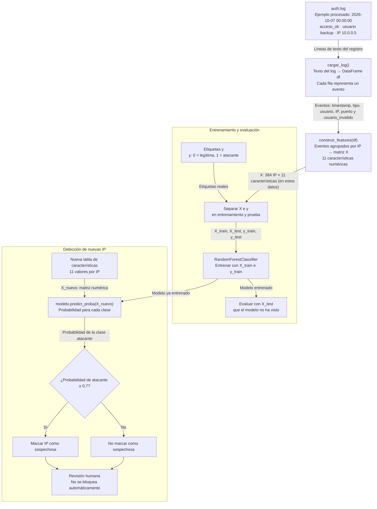

# Diagrama del flujo del sistema

**T1 Comprender** · Autora: Jia Xi

El sistema transforma las líneas de `auth.log` en eventos, agrupa los eventos por IP y utiliza 11 características numéricas. El entrenamiento y la detección de nuevas IP son pasos separados.

## Explicación de cada paso

1. **`auth.log` → eventos:** `cargar_log()` lee las líneas de texto y las convierte en un DataFrame llamado `df`. Cada fila representa un evento de autenticación.
2. **Eventos → características por IP:** `construir_features()` agrupa los eventos por IP y calcula 11 características, como `n_eventos`, `n_fallos`, `n_ok`, `n_usuarios` y `max_fallos_5min`. El resultado es la matriz `X`.
3. **Entrenamiento y evaluación:** el modelo `RandomForestClassifier` aprende con `X_train` e `y_train`. Después se evalúa con `X_test` e `y_test`, que se reservaron y no se utilizaron para entrenarlo.
4. **Detección:** para analizar nuevas IP, el modelo usa `predict_proba()` para obtener una probabilidad. Se compara la probabilidad de la clase atacante con el umbral `0,7`: si lo alcanza, la IP se marca como sospechosa.
5. **Decisión final:** el sistema informa de las IP sospechosas, pero no las bloquea automáticamente. Una persona debe revisar el resultado.

El ejemplo de `10.0.0.5` procede de una fila del DataFrame que aparece en el cuaderno. Las 11 características y el umbral `0,7` se han tomado de la información disponible en el proyecto.
