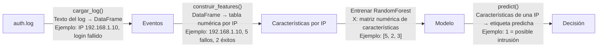

# Diagrama del flujo del sistema

**T1 Comprender** · Autora: Jia Xi

> Enunciado: log → eventos → características por IP → modelo → decisión. **En cada flecha hay que indicar qué datos viajan.**
> Se dibuja con Mermaid: GitHub lo convierte en imagen al abrir este fichero. Para probarlo antes de subirlo: <https://mermaid.live>

Plantilla de partida. Sustituye cada `¿?` por los datos que viajan (qué función se usa, qué forma tienen los datos y un ejemplo):

## Explicación de cada paso

1. **auth.log → eventos:**
La función `cargar_log()` lee el archivo `auth.log` y convierte sus líneas de texto en un DataFrame llamado `df`. Cada fila representa un evento de autenticación, por ejemplo, un inicio de sesión fallido de una IP.
2. **Eventos → características por IP:**
La función `construir_features()` agrupa los eventos por IP y calcula características numéricas, como el número de inicios de sesión fallidos y exitosos. El resultado es una tabla de características llamada `X`.
3. **Características → modelo:**
Se utiliza la matriz numérica `X` para entrenar un modelo `RandomForest`. También se utilizan las etiquetas reales `y` para que el modelo aprenda a distinguir entre las IP normales y las que presentan actividad sospechosa.
4. **Modelo → decisión:**
La función `predict()` utiliza el modelo entrenado para predecir la etiqueta de una IP. Por ejemplo, `0` puede representar una IP normal y `1` una posible intrusión, según cómo se hayan definido las etiquetas. El resultado sirve para informar del riesgo y requiere revisión humana; no implica bloquear automáticamente la IP.
