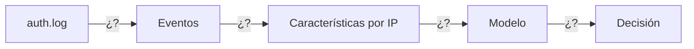

# Diagrama del flujo del sistema

**T1 Comprender** · Autora: Jia Xi

> Enunciado: log → eventos → características por IP → modelo → decisión. **En cada flecha hay que indicar qué datos viajan.**
> Se dibuja con Mermaid: GitHub lo convierte en imagen al abrir este fichero. Para probarlo antes de subirlo: <https://mermaid.live>

Plantilla de partida. Sustituye cada `¿?` por los datos que viajan (qué función se usa, qué forma tienen los datos y un ejemplo):

## Explicación de cada paso

1. **auth.log → eventos:**
2. **Eventos → características por IP:**
3. **Características → modelo:**
4. **Modelo → decisión:**
